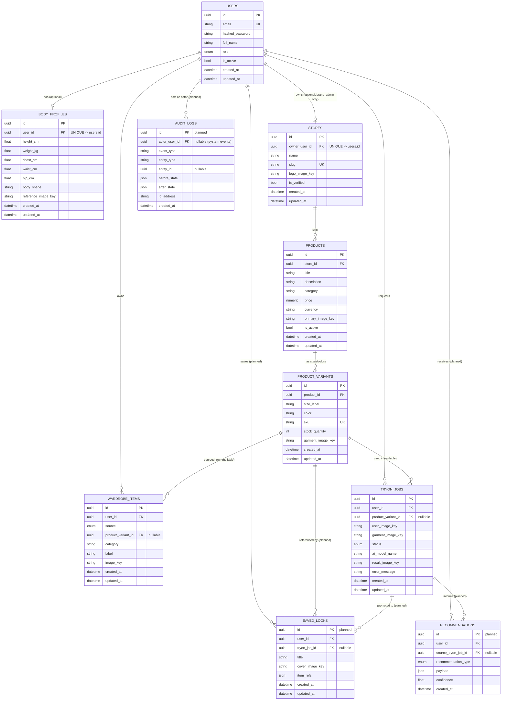

# Entity-Relationship Documentation

Status legend used throughout this file:
- **[implemented]** — exists today in `backend/app/models/`, has an Alembic
  migration path via `alembic revision --autogenerate`.
- **[planned]** — schema design agreed for a later phase (see `ROADMAP.md`).
  Not yet in `app/models/`, not yet migrated. Documented now so the API and
  frontend can be designed against a stable target shape.

Implemented tables: `users`, `body_profiles`, `stores`, `products`,
`product_variants`, `wardrobe_items`, `tryon_jobs`.
Planned tables: `saved_looks`, `recommendations`, `audit_logs`.

## 1. Entity-Relationship Diagram

## 2. Table-by-table detail

### `users` [implemented]
Central identity table for shoppers, brand admins, and platform admins.
| Column | Type | Nullable | Notes |
|---|---|---|---|
| `id` | UUID PK | no | |
| `email` | string(255) | no | unique, indexed |
| `hashed_password` | string(255) | no | bcrypt, never returned in any response |
| `full_name` | string(255) | yes | |
| `role` | enum(`shopper`,`brand_admin`,`platform_admin`) | no | default `shopper` |
| `is_active` | bool | no | default `true` |
| `created_at`/`updated_at` | timestamptz | no | |

### `body_profiles` [implemented]
One-to-one extension of `users`, holding measurements used by Size
Recommendation and Virtual Try-On fitting.
| Column | Type | Nullable | Notes |
|---|---|---|---|
| `id` | UUID PK | no | |
| `user_id` | UUID FK → `users.id` | no | **unique** — enforces 1:1 |
| `height_cm`, `weight_kg`, `chest_cm`, `waist_cm`, `hip_cm` | float | yes | all optional; profile can be partially filled |
| `body_shape` | string(50) | yes | free-form today; enum candidate later |
| `reference_image_key` | string(512) | yes | object storage key, not binary data |

### `stores` [implemented]
One-to-one extension of a `brand_admin` user (a user owns at most one store
in Phase 1/1.5/1.75 — see `MULTI_TENANCY.md` for planned multi-owner teams).
| Column | Type | Nullable | Notes |
|---|---|---|---|
| `id` | UUID PK | no | |
| `owner_user_id` | UUID FK → `users.id` | no | **unique** — enforces 1:1 |
| `name` | string(255) | no | |
| `slug` | string(255) | no | unique, indexed; used in public URLs |
| `logo_image_key` | string(512) | yes | |
| `is_verified` | bool | no | default `false`; platform admin gate |

### `products` [implemented]
| Column | Type | Nullable | Notes |
|---|---|---|---|
| `id` | UUID PK | no | |
| `store_id` | UUID FK → `stores.id` | no | indexed |
| `title` | string(255) | no | |
| `description` | text | yes | |
| `category` | string(100) | no | indexed |
| `price` | numeric(10,2) | no | |
| `currency` | string(3) | no | default `USD` |
| `primary_image_key` | string(512) | yes | |
| `is_active` | bool | no | default `true` |

### `product_variants` [implemented]
| Column | Type | Nullable | Notes |
|---|---|---|---|
| `id` | UUID PK | no | |
| `product_id` | UUID FK → `products.id` | no | indexed |
| `size_label` | string(20) | no | |
| `color` | string(50) | yes | |
| `sku` | string(100) | no | **unique** across the whole platform |
| `stock_quantity` | int | no | default `0` |
| `garment_image_key` | string(512) | yes | used as the default garment image for try-on |

### `wardrobe_items` [implemented]
| Column | Type | Nullable | Notes |
|---|---|---|---|
| `id` | UUID PK | no | |
| `user_id` | UUID FK → `users.id` | no | indexed |
| `source` | enum(`uploaded`,`catalog`) | no | |
| `product_variant_id` | UUID FK → `product_variants.id` | **yes** | only set when `source=catalog`; `ON DELETE SET NULL` |
| `category` | string(100) | no | |
| `label` | string(255) | yes | |
| `image_key` | string(512) | no | |

### `tryon_jobs` [implemented]
| Column | Type | Nullable | Notes |
|---|---|---|---|
| `id` | UUID PK | no | |
| `user_id` | UUID FK → `users.id` | no | indexed |
| `product_variant_id` | UUID FK → `product_variants.id` | **yes** | `ON DELETE SET NULL`; absent if garment was a raw upload |
| `user_image_key` | string(512) | no | |
| `garment_image_key` | string(512) | no | |
| `status` | enum(`pending`,`processing`,`completed`,`failed`) | no | indexed; default `pending` |
| `ai_model_name` | string(100) | yes | populated once a pipeline has run |
| `result_image_key` | string(512) | yes | populated only when `status=completed` |
| `error_message` | text | yes | populated only when `status=failed` |

### `saved_looks` [planned]
Lets a shopper bookmark a completed try-on (or a manually assembled
wardrobe combination) as a named "look" to revisit later.
| Column | Type | Nullable | Notes |
|---|---|---|---|
| `id` | UUID PK | no | |
| `user_id` | UUID FK → `users.id` | no | indexed |
| `tryon_job_id` | UUID FK → `tryon_jobs.id` | yes | set if the look originated from a try-on result; `ON DELETE SET NULL` |
| `title` | string(255) | yes | |
| `cover_image_key` | string(512) | no | |
| `item_refs` | JSON array of `wardrobe_item_id`/`product_variant_id` | yes | supports looks assembled from multiple pieces |

### `recommendations` [planned]
Output of the AI Stylist / Shopping Assistant (Phase 3/5 in `ROADMAP.md`).
Kept as durable rows (not just an API response) so recommendations can be
tracked, rated, and reused across sessions.
| Column | Type | Nullable | Notes |
|---|---|---|---|
| `id` | UUID PK | no | |
| `user_id` | UUID FK → `users.id` | no | indexed |
| `source_tryon_job_id` | UUID FK → `tryon_jobs.id` | yes | when a recommendation was triggered by a specific try-on |
| `recommendation_type` | enum(`outfit`,`size`,`product`) | no | |
| `payload` | JSON | no | shape depends on `recommendation_type` — see `AI_INTERFACES.md` |
| `confidence` | float | yes | 0.0–1.0 |

### `audit_logs` [planned]
Append-only event trail — see `AUDIT_LOGGING.md` for the full event catalog.
| Column | Type | Nullable | Notes |
|---|---|---|---|
| `id` | UUID PK | no | |
| `actor_user_id` | UUID FK → `users.id` | **yes** | null for system/worker-initiated events |
| `event_type` | string(100) | no | indexed; e.g. `user.login`, `product.updated` |
| `entity_type` | string(100) | no | e.g. `product`, `store`, `tryon_job` |
| `entity_id` | UUID | yes | the affected row's id, if applicable |
| `before_state` / `after_state` | JSON | yes | diffed snapshot for mutations; null for pure events (login) |
| `ip_address` | string(64) | yes | |
| `created_at` | timestamptz | no | no `updated_at` — rows are immutable |

## 3. Relationship rules

### One-to-one
- `users.id` ↔ `body_profiles.user_id` (unique FK)
- `users.id` ↔ `stores.owner_user_id` (unique FK)

Both are modeled as a one-to-many FK column that happens to carry a
`unique=True` constraint, rather than sharing a primary key — this keeps
open the (currently unused) option of relaxing to one-to-many later
without a primary-key migration.

### One-to-many
- `stores` → `products`
- `products` → `product_variants`
- `users` → `wardrobe_items`
- `users` → `tryon_jobs`
- `users` → `saved_looks` [planned]
- `users` → `recommendations` [planned]
- `users` → `audit_logs` [planned] (as actor)

### Nullable relations (and why)
| FK | Nullable? | Reason |
|---|---|---|
| `wardrobe_items.product_variant_id` | yes | wardrobe items can be raw personal uploads with no catalog link |
| `tryon_jobs.product_variant_id` | yes | the garment image can come from a raw upload instead of the catalog |
| `saved_looks.tryon_job_id` [planned] | yes | a look can be assembled manually, not just promoted from a try-on |
| `recommendations.source_tryon_job_id` [planned] | yes | not every recommendation is triggered by a specific try-on |
| `audit_logs.actor_user_id` [planned] | yes | system/worker events (e.g. a job auto-failing after retries) have no human actor |

### Cascade rules
| Parent → Child | On delete | Reasoning |
|---|---|---|
| `users` → `body_profiles` | `CASCADE` (ORM: `cascade="all, delete-orphan"`) | a body profile has no meaning without its user |
| `users` → `wardrobe_items` | `CASCADE` | personal data, deleted with the account |
| `users` → `tryon_jobs` | `CASCADE` | personal data, deleted with the account |
| `stores` → `products` | `CASCADE` | a product cannot exist without its store |
| `products` → `product_variants` | `CASCADE` | a variant cannot exist without its product |
| `product_variants` → `wardrobe_items.product_variant_id` | `SET NULL` | deleting a variant shouldn't delete a shopper's saved wardrobe item — it just loses its catalog link |
| `product_variants` → `tryon_jobs.product_variant_id` | `SET NULL` | job history is preserved even if the product is later removed |
| `users` → `stores.owner_user_id` | `CASCADE` | deleting a brand account removes its store (Phase 1.75 stance; revisit once team ownership lands — see `MULTI_TENANCY.md`) |
| `tryon_jobs` → `saved_looks.tryon_job_id` [planned] | `SET NULL` | a saved look should outlive the source job record if it's ever pruned |
| `users` → everything else [planned] | `CASCADE` (`saved_looks`, `recommendations`) / actor set `NULL` (`audit_logs`) | personal data deleted with the account; audit trail of *other* actors' actions about this user is retained for compliance, only the actor reference is nulled |

### Indexes
- Every FK column used in a `WHERE`/`JOIN` in the current codebase is
  indexed: `products.store_id`, `product_variants.product_id`,
  `wardrobe_items.user_id`, `tryon_jobs.user_id`.
- `tryon_jobs.status` is indexed — it's the primary filter for polling and
  for the Store Dashboard's job-count-by-status query.
- `users.email` is indexed (and unique) — the login lookup path.
- `stores.slug` is indexed (and unique) — public store lookup by slug.
- `products.category` is indexed — supports catalog browsing/filtering.
- Planned: `audit_logs.event_type` and `audit_logs.entity_id` (composite
  candidate: `(entity_type, entity_id)`) once implemented, since audit
  queries are almost always "show me everything that happened to X".

### Unique constraints
| Table | Column(s) | Purpose |
|---|---|---|
| `users` | `email` | one account per email |
| `body_profiles` | `user_id` | enforces 1:1 with `users` |
| `stores` | `owner_user_id` | enforces 1:1 with `users` (one store per brand account, today) |
| `stores` | `slug` | stable, human-readable public identifier |
| `product_variants` | `sku` | platform-wide inventory identifier |
