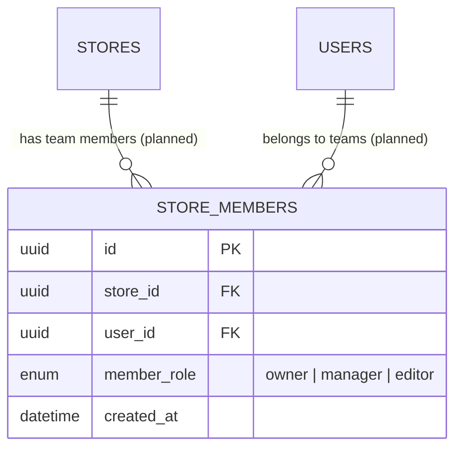

# Multi-Tenancy Design

FitMirror AI is a shared-database, shared-schema multi-tenant system: all
tenants (stores/brands) live in the same PostgreSQL database and tables,
isolated by foreign-key ownership rather than separate schemas/databases
per tenant. This section documents how isolation is enforced today and
what's planned as the platform grows.

## Store isolation

- Every `products` row belongs to exactly one `stores` row
  (`products.store_id`, `NOT NULL`, `ON DELETE CASCADE`).
- Every `product_variants` row belongs to exactly one `products` row, and
  transitively to one store.
- Store-scoped endpoints (`/store/*`) resolve the caller's store via
  `stores.owner_user_id = current_user_id` and then filter all product
  queries by that `store_id` — a brand admin can never see or modify
  another store's products, because the store lookup itself is
  ownership-scoped before any product query runs.
- There is no cross-store product query anywhere in the current codebase.
  A planned public catalog browse endpoint (see `ROADMAP.md`) will be the
  first intentionally cross-store read — it will expose only
  `is_active=true` products and no store-internal fields (stock
  quantities, unverified status, etc.).

## Brand admin ownership

- Today: **one store per `brand_admin` user**, enforced by
  `stores.owner_user_id` being `UNIQUE`. There is no concept of a store
  having multiple admin users yet.
- This is a deliberate Phase-1 simplification, not a permanent
  architectural ceiling — see "Future team support" below for the planned
  evolution path, which is additive (a new `store_members` table) rather
  than a change to the existing `stores.owner_user_id` column.

## Product visibility

| Viewer | Sees |
|---|---|
| The owning `brand_admin` | All of their store's products, active or not, via `/store/products` |
| Any other authenticated user | Nothing today — there's no product-read endpoint outside `/store/products`, which is ownership-scoped |
| Unauthenticated / public | Nothing today (planned: public catalog browse, `is_active=true` products only) |
| `platform_admin` | Same as owning brand_admin, via a planned admin override on the ownership check (not yet implemented) |

## User data isolation

- A user's `body_profiles`, `wardrobe_items`, and `tryon_jobs` rows are
  private to that user. Every read/write path filters by
  `user_id = current_user_id` (see the repository layer —
  `TryOnJobRepository.list_for_user`, wardrobe queries in
  `WardrobeService`, etc.).
- There is no endpoint anywhere that lets one shopper read another
  shopper's wardrobe, body profile, or try-on jobs. This is intentional
  and not planned to change — see `SECURITY.md` "image privacy".
- `platform_admin` access to another user's data is **planned, not
  implemented** — and when it lands, it should be logged via
  `audit_logs` (see `AUDIT_LOGGING.md`) precisely because it's a
  privacy-sensitive override of normal isolation.

## Future team support (planned)

Target schema addition (does not require changing `stores` or `products`):

- `stores.owner_user_id` remains the single "billing owner" /
  ultimate-authority account; `store_members` adds delegated access on
  top, without breaking the existing 1:1 ownership assumption anywhere
  else in the codebase.
- Permission scoping within a store (e.g. `editor` can manage products but
  not delete the store) extends `RBAC.md`'s matrix with a
  store-scoped sub-matrix.
- This is explicitly **planned**, not started — no `store_members` table,
  model, or endpoint exists yet.

## Audit log ownership (planned — see `AUDIT_LOGGING.md`)

- `audit_logs.actor_user_id` records *who* performed an action, but the
  log entry itself is not "owned" by that user in the isolation sense —
  audit logs are a `platform_admin`-only resource by design (a store owner
  should not be able to read or tamper with the audit trail of actions
  taken against their own store, since that would defeat the trail's
  purpose).
- When multi-tenant teams (above) land, `entity_type='store'` audit
  entries should be readable by that store's `owner`/`manager` members in
  a scoped view — this is a planned refinement, not part of the initial
  audit log design.

## What shared-schema multi-tenancy means for scaling

- Row-level isolation via foreign keys is simple to reason about and
  sufficient at current scale. It does **not** provide database-level
  hard isolation (a bug in a query's `WHERE` clause could theoretically
  leak cross-tenant data — there's no Postgres Row-Level Security policy
  enforcing it at the database layer today).
- **Planned hardening (tracked in `ROADMAP.md` Phase 8):** evaluate
  Postgres Row-Level Security (RLS) policies as a defense-in-depth layer
  once there are enough tenants that a manual code-review safety net is
  no longer sufficient on its own.
