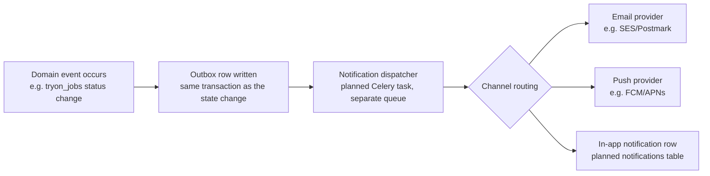

# Notification Architecture (Placeholder)

## Current state

**Transactional email exists; event notifications don't yet.** Phase 3.2
added `app/services/email_service.py` — an `EmailSender` with a `log`
backend (default: the email is written to the application log) and an
`smtp` backend — used for password-reset links and for forwarding
contact-form messages to `SUPPORT_EMAIL`. Emails are sent from FastAPI
`BackgroundTasks` after the request commits; there is no outbox or retry
yet (the architecture below). There is no push/in-app notification code. Clients learn about job
completion exclusively by polling `GET /tryon/{job_id}` (see
`SEQUENCE_DIAGRAMS.md` §6, `QUEUE_ARCHITECTURE.md`). This document is a
placeholder design for when push-style notifications are built.

## Why polling today, not push

At current scope (one job type, short-lived jobs, no frontend yet), the
operational simplicity of "client polls a REST endpoint" outweighs the
benefit of a push channel. Building notification infrastructure (delivery
provider integration, user notification preferences, a queue for
notification dispatch) ahead of having a frontend to consume it would be
premature. This is deliberately deferred, not overlooked.

## Planned notification events

| Event | Trigger | Planned recipient | Planned channel(s) |
|---|---|---|---|
| Job completed | `tryon_jobs.status → completed` | The requesting shopper | Push (mobile), in-app badge; email optional/configurable |
| Job failed | `tryon_jobs.status → failed` | The requesting shopper | Push, in-app; include a retry action |
| Product imported | Planned bulk product import completes (see `ROADMAP.md` Phase 7) | The importing brand admin | In-app, email (import results/errors summary) |
| Store approved | Planned store verification workflow sets `is_verified=true` | The store's owner | Email (this unblocks their ability to operate — worth a reliable channel, not just in-app) |
| Recommendation ready | Planned — Stylist/Shopping Assistant (Phase 3/5) finishes an async recommendation | The requesting shopper | In-app; push if the recommendation was requested and the app is backgrounded |

## Planned architecture



- **Outbox pattern, not direct dispatch inline in the request/task path.**
  The service that changes state (e.g. `process_tryon_job` marking a job
  `completed`) writes a notification-intent row in the *same* database
  transaction as the state change, rather than calling an email/push
  provider directly inline. This guarantees the notification intent is
  never lost even if the provider call fails, and decouples job-processing
  latency from notification-delivery latency.
- **Separate Celery queue** (`notifications`, alongside `tryon` — see
  `QUEUE_ARCHITECTURE.md`) for the dispatcher, so a slow/rate-limited
  notification provider never blocks try-on job throughput.
- **Idempotent dispatch:** each outbox row is marked dispatched only after
  a successful provider call, using the same at-least-once + idempotency
  posture as `QUEUE_ARCHITECTURE.md`'s planned job-idempotency guard.

## Planned schema addition

```
notifications (planned — not yet implemented)
├── id (PK, uuid)
├── user_id (FK -> users.id)
├── notification_type (string)   e.g. "tryon_job.completed"
├── payload (JSON)                 e.g. {job_id, result_image_key}
├── channel (enum: in_app | email | push)
├── status (enum: pending | sent | failed)
├── read_at (timestamptz, nullable)   for in_app notifications
├── created_at
```

This is intentionally similar in shape to `tryon_jobs` (a status-bearing,
polled-or-pushed async record) — consistent with the platform's existing
job-status conventions rather than inventing a new pattern.

## User preferences (planned, later)

Channel opt-in/opt-out (e.g. "push only, no email") requires a
`notification_preferences` table or a JSON column on `users` — not
designed in detail yet, since it depends on which channels actually ship
first. Flagged here so it isn't forgotten when notification work begins.

## What this document is not

This is not a commitment to build notifications in the very next phase —
check `ROADMAP.md` for actual phase sequencing. It exists so that when
notification work does start, it has a design to build against instead of
starting from a blank page, and so that other planned features
(`saved_looks`, `recommendations`, store verification) are designed with
their eventual notification hook points already in mind.
