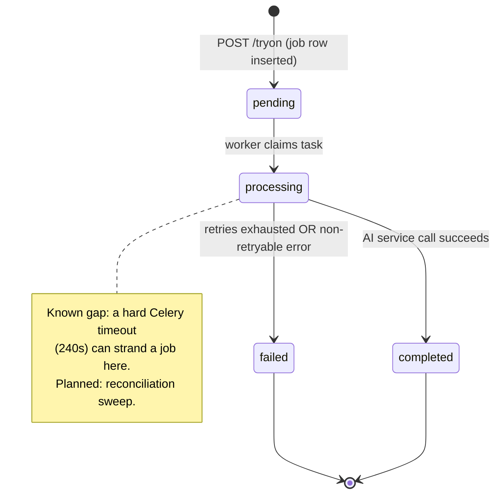

# Queue / Event Architecture

Documents the Celery-based async job system (`app/workers/`) underlying
Virtual Try-On today, and the design rules any future async job type
(recommendation generation, bulk import, etc. — planned) should follow.

## Celery queues

| Queue | Purpose | Consumer |
|---|---|---|
| `tryon` | Try-on job processing (`process_tryon_job`) | The `worker` container/service |

Scheduled work (`maintenance.apply_data_retention`, daily) also runs on this
queue. It's triggered by the `beat` service, which must run as exactly one
replica.

Configuration (`app/workers/celery_app.py`):
```python
task_default_queue = "tryon"
task_acks_late = True
worker_prefetch_multiplier = 1
task_track_started = True
task_time_limit = 240        # hard kill after 240s
task_soft_time_limit = 210   # SoftTimeLimitExceeded raised at 210s (above the 180s AI HTTP timeout)
```

- **Single queue today.** All async work funnels through `tryon`. This is
  appropriate at current scope (one job type). **Planned:** as
  Recommendations (planned `recommendations` table, see `ERD.md`) and any
  future bulk operations (product import) get async processing, they
  should get their **own dedicated queues** (e.g. `recommendations`,
  `imports`) rather than sharing `tryon` — so a burst of one job type
  can't starve another, and so `worker` replicas can be scaled/dedicated
  per queue (`celery -A ... worker -Q recommendations`).
- `task_acks_late=True` + `worker_prefetch_multiplier=1`: a task is only
  acknowledged (removed from the queue) after it completes — if a worker
  process crashes mid-task, Redis redelivers it to another worker instead
  of silently losing it. Prefetch of 1 avoids one worker hoarding multiple
  jobs while others sit idle.

## Retry strategy

```python
@celery_app.task(
    bind=True,
    autoretry_for=(httpx.HTTPError,),
    retry_backoff=True,
    retry_backoff_max=60,
    max_retries=3,
)
def process_tryon_job(self, job_id: str) -> None: ...
```

- Only `httpx.HTTPError` (network failures, non-2xx from the AI service)
  triggers an automatic retry — a `KeyError`/`ValueError`/programming bug
  is **not** retried, since retrying a deterministic bug just wastes time
  before failing anyway (see the `except Exception` fallthrough that
  marks the job `failed` immediately for non-`HTTPError` exceptions).
- Exponential backoff (`retry_backoff=True`, capped at `retry_backoff_max=60s`)
  — avoids hammering a struggling AI service with immediate retries.
- After 3 retries, the job is marked `failed` with `error_message` set to
  the final exception's string representation.
- **This is the mechanism behind `AI_SERVICE_UNAVAILABLE`** (see
  `ERROR_CODES.md`): a fully-exhausted-retries scenario surfaces as a
  `failed` job, not as a direct API error response — the client only ever
  sees this via polling `GET /tryon/{job_id}`.

## Dead-letter strategy (placeholder — planned)

No dead-letter queue exists today. A job that exhausts retries is marked
`failed` in Postgres (which *is* a durable record — nothing is silently
dropped), but there's no separate mechanism to:
- Alert on elevated failure rates.
- Manually re-drive a batch of failed jobs.
- Distinguish "worth retrying later" failures (e.g. AI service was down
  for a deploy) from "will never succeed" failures (e.g. a corrupt image).

**Planned:** a Celery dead-letter queue (or a scheduled query over
`tryon_jobs WHERE status='failed'`) feeding into the planned notification
system (`NOTIFICATIONS.md`) and an admin-only "retry job" endpoint (see
`RBAC.md` admin operations).

## Job timeout policy

| Layer | Timeout | Behavior on expiry |
|---|---|---|
| Backend → AI service HTTP call | `AI_SERVICE_TIMEOUT_SECONDS` (default 30s) | `httpx.HTTPError` (timeout) → counts as a retryable failure |
| Celery soft time limit | 210s | `SoftTimeLimitExceeded` raised inside the task — caught by the generic `except Exception`, job marked `failed` |
| Celery hard time limit | 240s | Task process is killed unconditionally; job is left in whatever state it was last updated to (`processing`, most likely) — **known gap**, see below |

**Known gap (planned fix):** a hard-time-limit kill doesn't get a chance
to update the job row to `failed` — the job could be left stuck in
`processing` indefinitely. Planned: a periodic reconciliation task
(`process_tryon_job` results checked against a max-age threshold; any
`processing` job older than, say, `task_time_limit + buffer` gets swept to
`failed` with `error_message="Job exceeded maximum processing time."`).

## Idempotency rules

- `process_tryon_job(job_id)` is idempotent **in effect**, not by
  construction: re-running it for the same `job_id` re-fetches the job,
  re-sets it to `processing`, and re-calls the AI service — if the job was
  already `completed`, this would incorrectly re-process it.
- **Current mitigation:** Celery only delivers a task once per `.delay()`
  call, and `.delay()` is only called once per job (at creation time in
  `TryOnService.create_job`) — so double-processing doesn't happen in
  practice today, but the task function itself has no guard against being
  called twice for the same `job_id`.
- **Planned hardening:** add an explicit guard at the top of
  `process_tryon_job` — if the job's current status is already
  `completed` or `failed`, log and return immediately rather than
  reprocessing. This matters more once a dead-letter/manual-retry
  mechanism (above) exists, since that introduces a second code path that
  could call `.delay()` for an already-processed job.
- The AI service's `/tryon/generate` endpoint is **not** idempotent by
  `job_id` — calling it twice with the same `job_id` runs the pipeline
  twice and returns two different `result_image_key`s (the placeholder
  pipeline has no deduplication). This is acceptable given the worker-side
  mitigation above, but should be revisited if the guard in the previous
  bullet is implemented — the two should be designed together.

## Status transition rules



Enforced transitions (`TryOnJobRepository.set_status`, called only from
`process_tryon_job`):
- `pending → processing`: unconditional, first action of the task.
- `processing → completed`: only on a successful AI service response,
  always setting `result_image_key` and `ai_model_name` together.
- `processing → failed`: only on exhausted retries or a non-retryable
  exception, always setting `error_message`.
- **No transition ever moves a job backward** (e.g. `completed →
  processing`) — `completed` and `failed` are terminal states in the
  current implementation. This is consistent with `RESPONSE_STANDARDS.md`
  §5's job status table.
- There is currently no explicit state-machine validation in code (no
  `if current_status not in ALLOWED_PREVIOUS_STATES: raise` guard) — the
  transitions above hold because of the linear structure of
  `process_tryon_job`, not because of an enforced state machine. Planned,
  alongside the idempotency hardening above: make transitions
  self-validating so a future code change can't accidentally violate them.

## Planned: event architecture beyond Celery tasks

Today, "events" are implicit (a job status change), consumed only by
whoever polls `GET /tryon/{job_id}`. Planned evolution (see
`NOTIFICATIONS.md`):
- Emit an explicit event (e.g. via a Redis pub/sub channel or a
  lightweight outbox table) on every `tryon_jobs` status transition, so a
  future notification worker (or a websocket gateway, for push-based
  status updates instead of polling) can subscribe without querying
  Postgres directly.
- This is intentionally **not** built in Phase 1.75 — polling is
  sufficient for current scope, and adding a pub/sub layer now would be
  premature infrastructure for a single job type.
