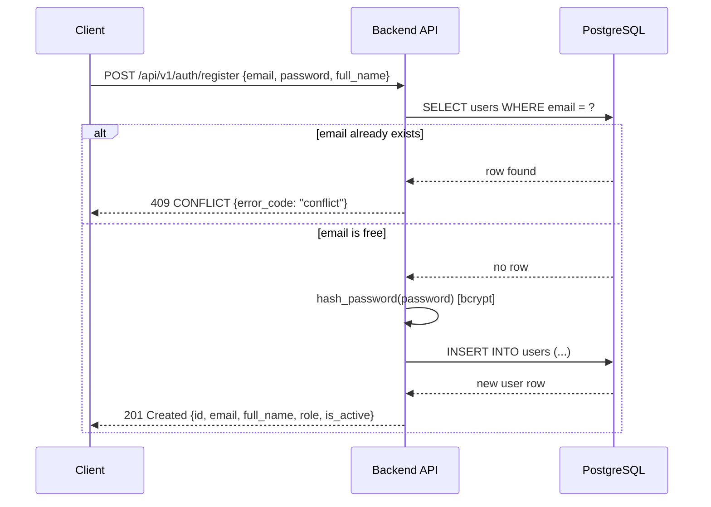
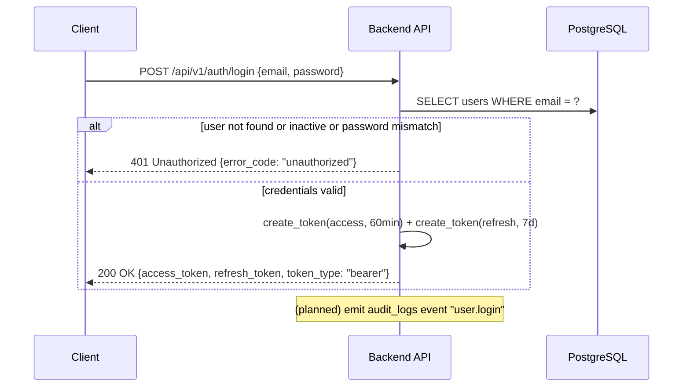
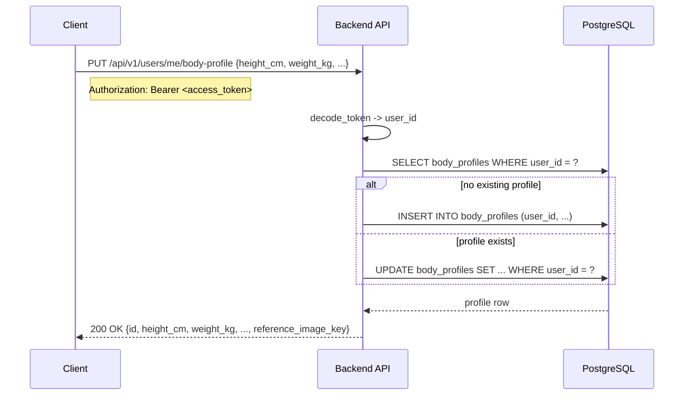
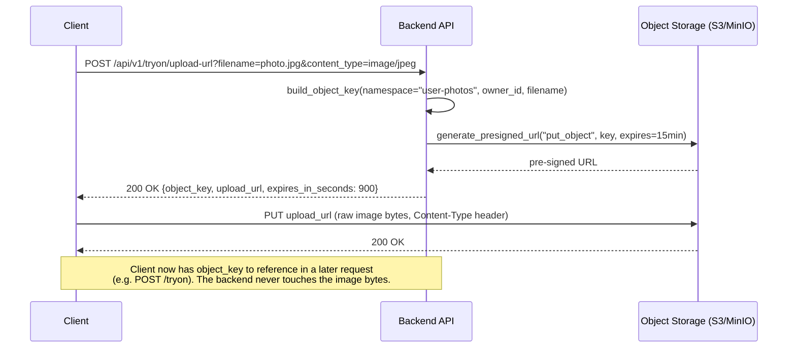
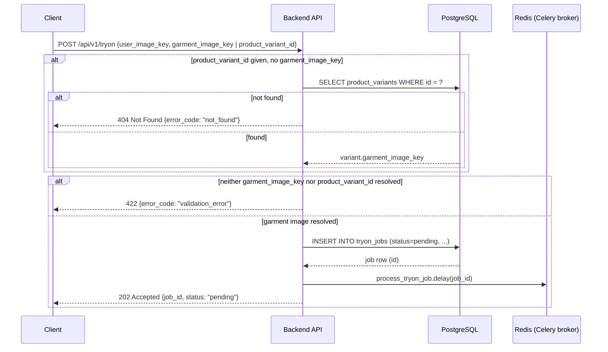
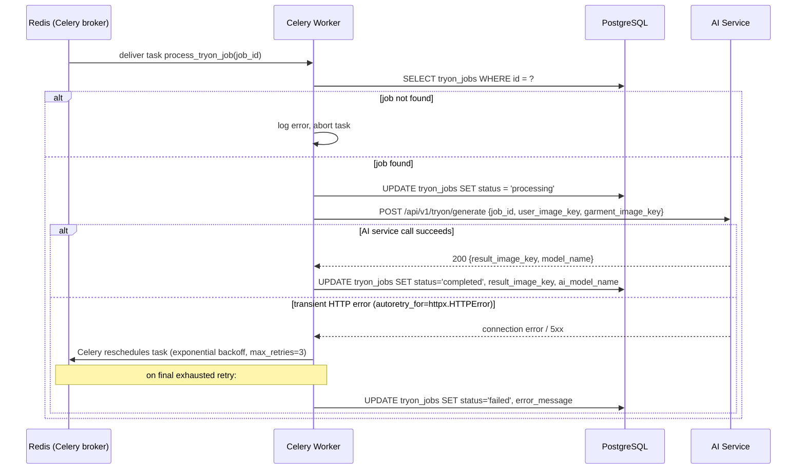
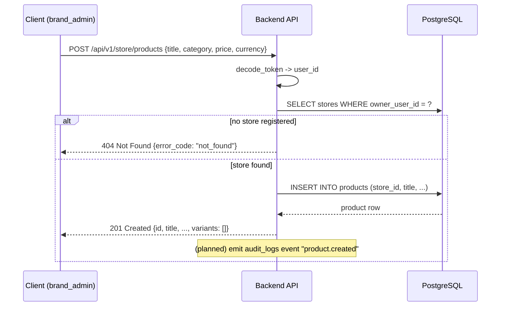
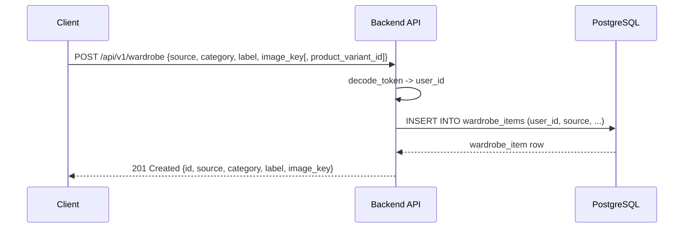
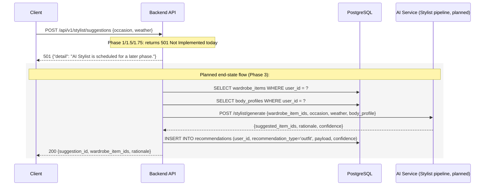

# Sequence Diagrams

All diagrams reflect the **current, implemented** flow unless a step is
explicitly marked `(planned)`. See `ROADMAP.md` for phase context on
planned steps.

## 1. User registration



## 2. Login



## 3. Profile setup (body profile)



## 4. Upload image using a pre-signed URL



## 5. Create try-on job



## 6. Celery worker processing



## 7. AI service generation (inside the AI service)

```mermaid
sequenceDiagram
    participant W as Celery Worker (caller)
    participant AI as AI Service (FastAPI)
    participant Reg as Model Registry
    participant P as TryOnPipeline impl
    participant S3 as Object Storage

    W->>AI: POST /api/v1/tryon/generate {job_id, user_image_key, garment_image_key}
    AI->>Reg: get_tryon_pipeline()
    Reg-->>AI: pipeline instance (resolved from TRYON_MODEL_NAME)
    AI->>P: run(TryOnInput(job_id, user_image_key, garment_image_key))
    P->>S3: read_object(user_image_key)
    S3-->>P: image bytes
    P->>S3: read_object(garment_image_key)
    S3-->>P: image bytes
    P->>P: generate result (placeholder: overlay banner;<br/>real model (planned): actual garment compositing)
    P->>S3: write_object(result_bytes, namespace="tryon-results")
    S3-->>P: result_image_key
    P-->>AI: TryOnOutput(result_image_key, model_name)
    AI-->>W: 200 {job_id, result_image_key, model_name}
```

## 8. Store product creation



## 9. Wardrobe item creation



## 10. Outfit recommendation request (planned — Phase 3)


