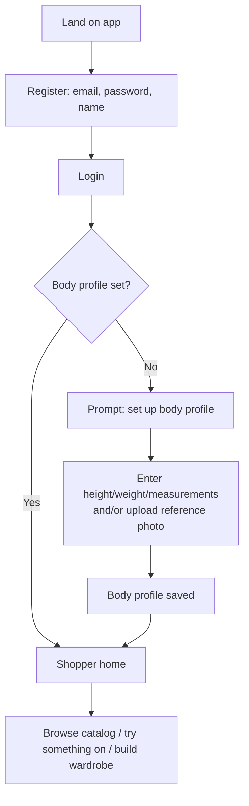
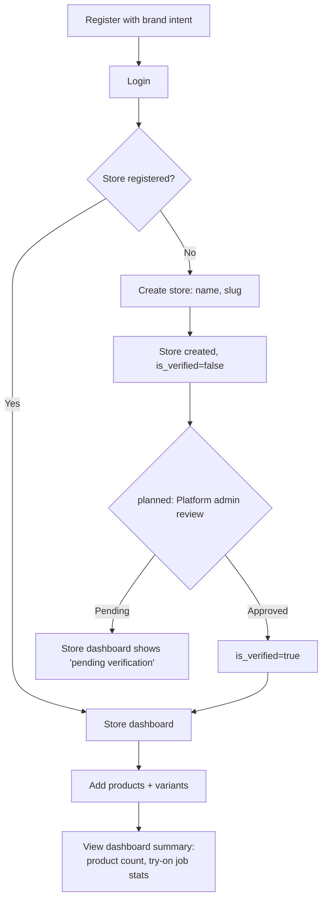
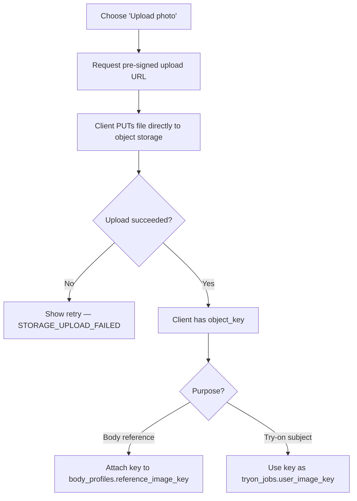
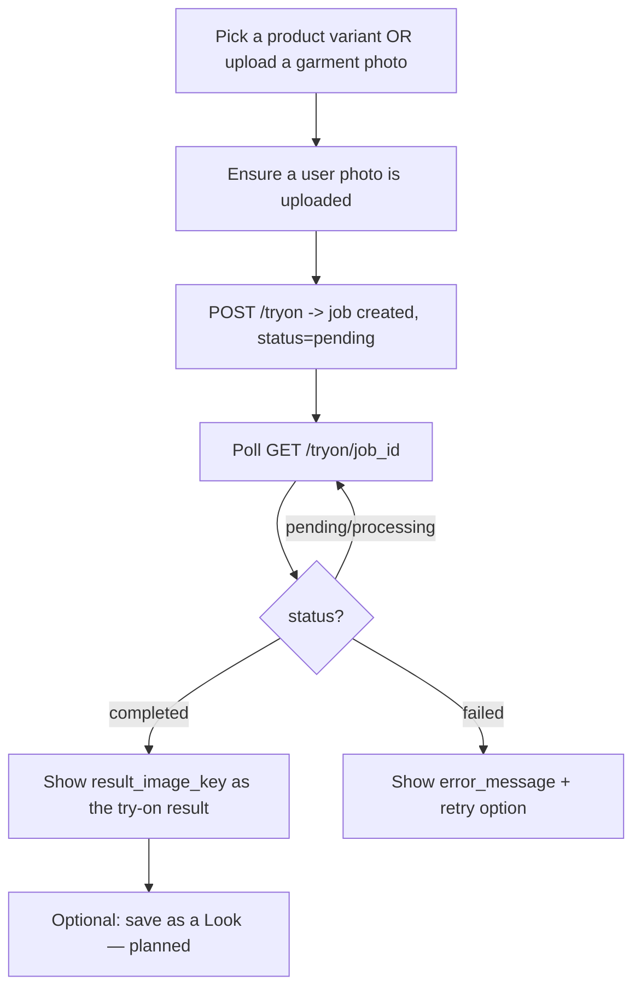
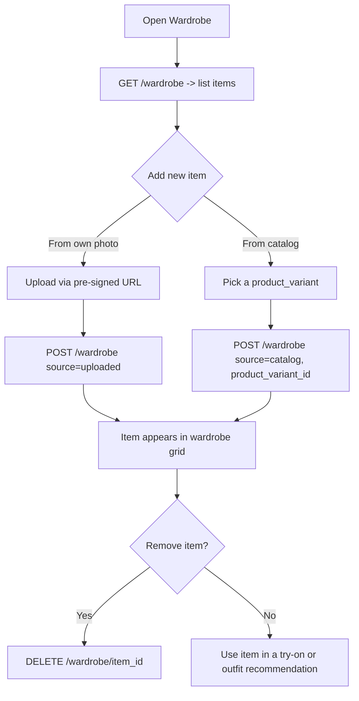
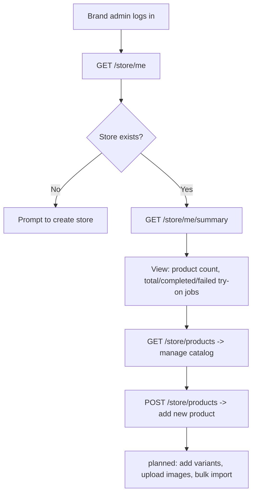
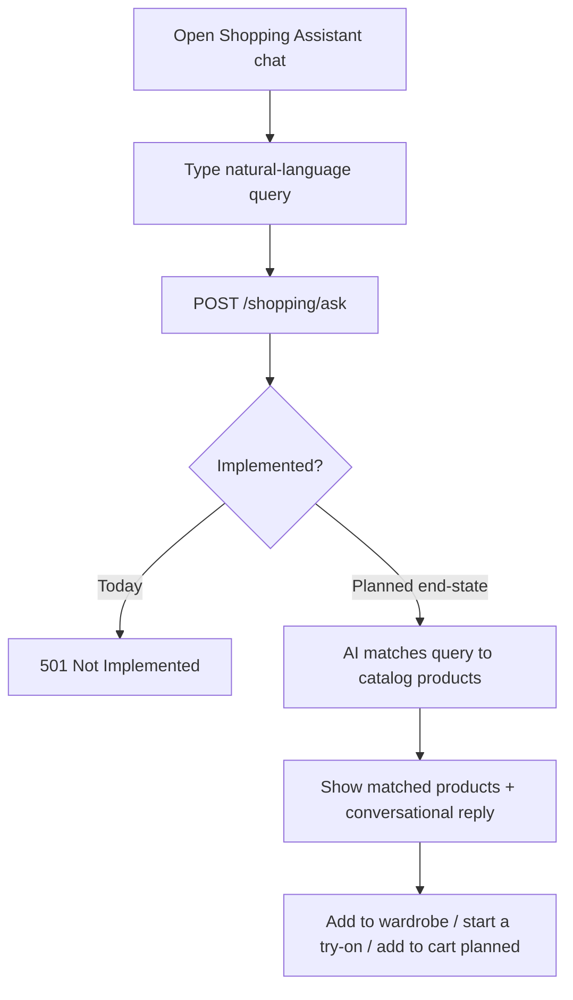

# User Flows

High-level user journeys, distinct from `SEQUENCE_DIAGRAMS.md` (which shows
system-internal request/response detail). These flows show what the
*person* experiences, screen-to-screen — useful input for Phase 2 frontend
design even though no frontend exists yet.

## 1. Shopper onboarding



- Body profile is optional at registration time — a shopper can skip it and
  browse, but Size Recommendation (planned) and best-fit Try-On results
  depend on it, so the UI should nudge without blocking.
- Endpoints involved: `POST /auth/register`, `POST /auth/login`,
  `GET /users/me/body-profile`, `PUT /users/me/body-profile`.

## 2. Brand onboarding



- Today, `role` is set at the account level (`brand_admin`), not derived
  from store ownership — a `brand_admin` user simply hasn't created a
  store yet until step D. There's no separate "apply to become a brand"
  approval gate in Phase 1/1.5/1.75; `is_verified` exists on `stores` but
  the review workflow that flips it is **planned** (see `NOTIFICATIONS.md`
  → "store approved").
- Endpoints involved: `POST /store`, `GET /store/me`, `GET /store/me/summary`,
  `POST /store/products`, `GET /store/products`.

## 3. Upload body photo



- The backend never sees the raw image bytes — see `STORAGE.md` for the
  pre-signed URL contract. This is the same flow for garment photos and
  wardrobe uploads; only the target `namespace` and where the resulting
  key is attached differ.

## 4. Try-on flow



- Recommended poll interval: 2s with backoff (see `API_CONTRACTS.md`).
- Step H (Saved Looks) is **planned** — see `saved_looks` in `ERD.md`.

## 5. Wardrobe flow



## 6. Store dashboard flow



## 7. Saved looks flow (planned — see `saved_looks` in `ERD.md`)

```mermaid
flowchart TD
    A[Completed try-on result] --> B[Tap 'Save as Look']
    B --> C[POST /looks planned: {tryon_job_id, title}]
    C --> D[Look appears in 'My Looks' gallery]
    D --> E{Revisit later}
    E --> F[GET /looks/look_id planned]
    F --> G[Re-run try-on with same items, or share — planned]
```

## 8. Shopping assistant flow (planned — Phase 5)



- Today (`Phase 1.75`), this flow terminates at step E — the contract
  exists (`POST /shopping/ask` returns request/response shapes in
  `API_CONTRACTS.md`) but always responds `501`. The rest of the diagram
  documents the intended end-state so frontend work can anticipate the
  eventual UI shape.
