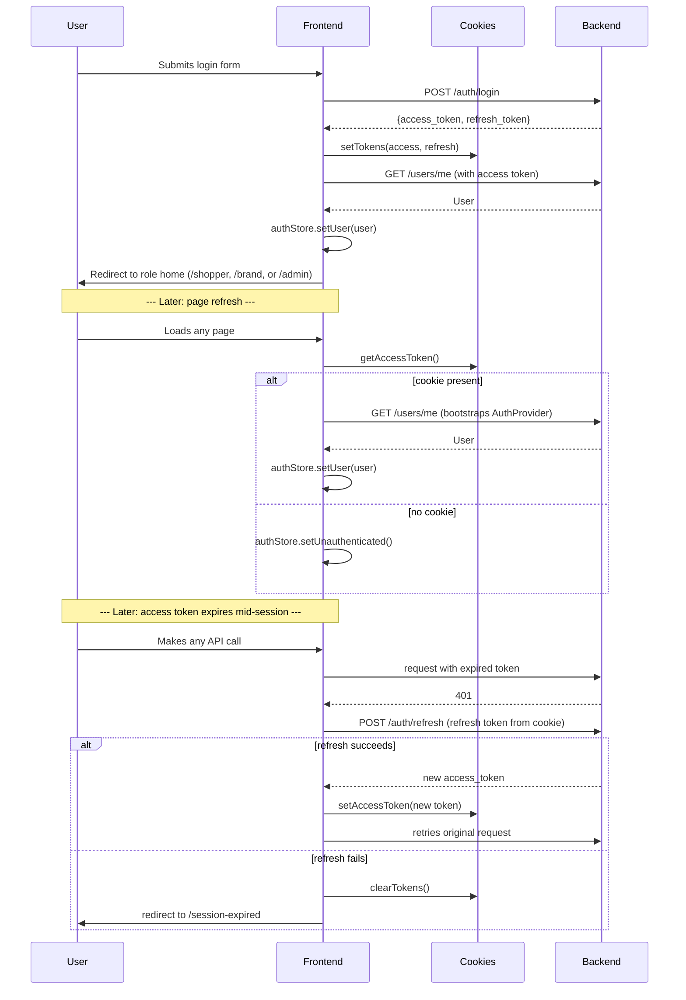

# Authentication

Covers the real (not placeholder) authentication system built in Phase
2.2: login, register (shopper or brand account), forgot/reset password,
session persistence, logout, and role-based route protection.

## Session lifecycle

## Why cookies, not localStorage (and not httpOnly cookies)

Phase 2.1 stored the access token in an in-memory JS variable — it didn't
survive a refresh and, more importantly, **Next.js middleware can't read
it**, so real route protection was impossible. Phase 2.2 moves token
storage to cookies (`lib/cookies.ts`, `lib/auth-token.ts`) specifically so
`middleware.ts` (which runs at the edge, before any client JS) can check
session state on every navigation.

These are **plain, client-set cookies, not httpOnly**. A true httpOnly
cookie can only be set by the server via a `Set-Cookie` response header —
the backend's `POST /auth/login` returns tokens in the JSON body (see
backend `docs/API_CONTRACTS.md`), not a cookie header, and changing that
is a backend change out of scope for this frontend phase (per Phase 2.2's
"do not change backend APIs unless unavoidable" rule). This is a
documented trade-off, not an oversight: these cookies carry the same
XSS-readability exposure as localStorage would have. **Planned:** if/when
the backend is changed to set an httpOnly cookie directly on login,
`lib/auth-token.ts` and `middleware.ts`'s cookie-reading logic can be
simplified (or removed client-side entirely) without touching any
component that calls `useAuth()`.

## Where each piece lives

| Concern | File |
|---|---|
| Cookie read/write primitives | `lib/cookies.ts` |
| Cookie names + lifetimes (shared by client + middleware) | `lib/auth-constants.ts` |
| Token get/set/clear (built on the above) | `lib/auth-token.ts` |
| JWT payload decode, no signature verification | `lib/jwt.ts` |
| Persisted `user` state (Zustand) | `lib/stores/auth-store.ts` |
| Session bootstrap, `login()`/`logout()`, `useAuth()` | `providers/auth-provider.tsx` |
| Backend calls (login/register/refresh/current-user/forgot-password) | `features/auth/api.ts` |
| Zod schemas | `features/auth/schemas.ts` |
| Mutation/query hooks | `features/auth/hooks/*` |
| Forms | `features/auth/components/*` |
| Route protection decision logic (pure, tested) | `middleware/auth-guard.ts` |
| Middleware entrypoint | `middleware.ts` |

## Why JWT payload decoding without verification is safe here

`lib/jwt.ts::decodeJwtPayload` reads a token's claims (notably `role`)
**without verifying its signature**. This is intentional and safe because:

1. It's used only for **routing UX** (which dashboard to redirect a role
   to, whether to show `/unauthorized`) — never as an authorization
   decision that gates access to real data.
2. **Every real API call is independently verified server-side** (see
   backend `app/core/security.py::decode_token`) — a tampered/forged
   token would simply get `401`s on every actual request, regardless of
   what middleware decided about routing.
3. Worst case if someone forged a token client-side to fool the role
   check: they'd see a dashboard *shell* (layout only, since Phase 2.2
   still has only placeholder page content — see backend
   `docs/RBAC.md`) with zero real data, because every data-fetching call
   the shell would eventually make still requires a validly-signed token.

## Role-based redirects

| Role | Home route |
|---|---|
| `shopper` | `/shopper` |
| `brand_admin` | `/brand` |
| `platform_admin` | `/admin` |

Defined once in `middleware/auth-guard.ts::ROLE_HOME` and reused by
`features/auth/components/login-form.tsx` (post-login redirect) — not
duplicated between the two.

## Route protection categories

| Category | Examples | Behavior |
|---|---|---|
| Public | `/`, `/features`, `/pricing`, `/about`, `/contact`, `/privacy`, `/terms` | Always reachable |
| Guest-only | `/login`, `/register`, `/forgot-password` | Redirects an **authenticated** visitor to their role home |
| Authenticated + role-scoped | `/shopper/*`, `/brand/*`, `/admin/*` | Redirects an unauthenticated visitor to `/login?redirectTo=...`; redirects a wrong-role visitor to `/unauthorized`; redirects a visitor with an expired-but-refreshable session to `/session-expired` |

All of this logic is pure, exported functions in `middleware/auth-guard.ts`
(`resolveSessionState`, `decideRedirect`, `isGuestOnlyRoute`,
`matchProtectedRolePrefix`) — unit-tested directly in
`tests/unit/middleware/auth-guard.test.ts` without needing to run
middleware in an actual edge runtime.

## `/session-expired` vs. `/unauthorized` vs. `/login`

Three distinct pages exist because they mean three different things:

- **`/login`** — no session at all. First-time visitor, or a fully logged
  -out one.
- **`/session-expired`** — *was* logged in; the access token expired and
  there was no way to silently refresh (either the refresh token is also
  gone/expired, or this was a full page navigation middleware couldn't
  refresh proactively — see "What middleware does NOT do" below).
- **`/unauthorized`** — currently logged in, just as the wrong role for
  the requested page (e.g. a `shopper` visiting `/brand`).

## What middleware does NOT do (by design)

Middleware never makes a network call to refresh a token — it only reads
the access-token cookie and, if expired, checks whether a refresh-token
cookie is *present* (not whether it's still valid) to decide between
`/login` and `/session-expired`. Attempting a real refresh at the edge on
every navigation would add latency to every request; the client-side
`api/client.ts` interceptor already handles silent refresh for actual API
calls (XHR/fetch), which is where it matters most (a full page navigation
hitting an expired token is a rarer edge case, and simply asking the user
to log in again there is an acceptable trade-off).

## Password reset and account self-service (Phase 3.2)

- `/forgot-password` calls `POST /auth/forgot-password`, which emails a
  single-use link to `/reset-password?token=…` (valid 30 minutes; the
  answer never reveals whether the email is registered). In local dev
  (`EMAIL_BACKEND=log`) the email — link included — is written to the
  backend log.
- `/reset-password` (`features/auth/components/reset-password-form.tsx`)
  sets the new password; an unknown, used or expired link shows the
  server's message plus a "send a new one" link. The route is public (not
  guest-only), so the link works even while signed in.
- A reset or a password change sets `users.password_changed_at`; refresh
  tokens issued before it are rejected, so other sessions end at their
  next refresh. Changing your password in Settings returns fresh tokens,
  so the current session carries on.
- Settings (Shopper and Brand) share `features/auth/components/account-settings.tsx`:
  edit your name (`PATCH /users/me`) and change your password.
- Register asks "I'm shopping" / "I'm a brand"; `/register?type=brand`
  (the landing page's "Open your store") preselects a brand account,
  which lands on store setup after logging in.

## Logout

No backend call is involved — see backend `docs/SECURITY.md` "JWT":
tokens are stateless, so there's nothing to revoke server-side.
`useAuth().logout()` clears both cookies, clears the persisted Zustand
`user`, clears the entire TanStack Query cache (so no stale data from the
previous session lingers), and redirects to `/login`.

## Testing

| What | Where |
|---|---|
| JWT decode/expiry | `tests/unit/lib/jwt.test.ts` |
| Cookie read/write | `tests/unit/lib/cookies.test.ts` |
| Token storage (built on cookies) | `tests/unit/lib/auth-token.test.ts` |
| Route-protection decision logic | `tests/unit/middleware/auth-guard.test.ts` |
| Login form validation | `tests/unit/features/login-form.test.tsx` |
| Zod schemas (login/register/forgot-password) | `tests/unit/features/auth-schemas.test.ts` |
| e2e: auth pages render, middleware redirects | `tests/e2e/smoke.spec.ts` "Route protection (middleware)" |

There is currently no e2e test that logs in with real credentials and
reaches an authenticated dashboard — that requires a seeded backend
account and is left for when dashboard pages have real content to verify
(see `ROADMAP.md` Phase 2.3+).
